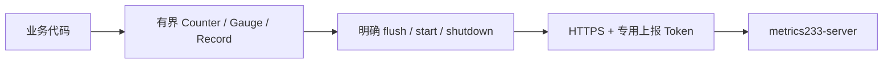

# metrics233-client-sdk-typescript

TypeScript/Node 18+ 上报 SDK，零运行时依赖。ESM 和类型声明，通过原生 `POST /api/v1/ingest` 协议发送到 [metrics233-server](https://github.com/neko233-com/metrics233-server)。

```ts
import { Metrics233 } from "metrics233-client-sdk-typescript";

const metrics = new Metrics233({
  endpoint: process.env.METRICS233_URL!,
  token: process.env.METRICSPANEL_INGEST_TOKEN!,
  labels: { service: "game-api", role: "logic", serverId: "1", instance: "node-1", environment: "test", implementation: "typescript" },
});
metrics.withLabels({ result: "success" }).counter("game_requests_total", 1);
metrics.gauge("game_players_online", 42);
await metrics.flush();
await metrics.shutdown();
```

构造不会读环境变量、联网或启动任务。需要定期发送时显式调用 `start(15000)`；关闭时 `await shutdown()`。`withLabels()` 创建共享同一容量、队列和生命周期的视图；`counter()` 累加非负增量，`gauge()` 保存最新有限数值，`record()` 排队单个带毫秒时间戳的样本。一个指标名不能混用类型。



默认最多 1000 条生命周期序列、1000 个待发送原始记录、每批 500 点，单请求不超过 4 MiB。序列上限可配置到 100000，批次上限 10000；不会以持续变化的玩家 ID、完整 IP、请求 ID 作为标签。定时任务不重叠，刷新合并并发调用，更新在下一轮或当前剩余轮发送。`stats()` 提供发送状态和无凭据错误码。

默认总网络发送预算 5 秒。网络失败、429/5xx 最多重试两次；遵守有上限的 Retry-After，跨 `flush()` 保留等待时间。其他状态或不完整 ACK 立即失败。每批必须返回匹配全部样本数量的 `{ "accepted": N }`；未确认批次保留完全相同的字节和时间戳。已确认批次不重发。关闭失败时保留 closing 状态和剩余数据，可再次 `shutdown()`。进程退出不会自动落盘或发送；不承诺跨进程可靠队列或分布式 exactly-once。

只允许正常验证证书的 HTTPS。开发时 `allowHttpLoopback: true` 只放行本机 HTTP。拒绝 URL 用户名、密码、query 和 fragment；禁止重定向和 cookie。错误不包含 URL、Token 或服务端响应正文。

**浏览器/公开游戏客户端通过自己的业务后端中转**，中转端校验玩家身份、限制指标/频率并返回同样的 ACK；不要向玩家分发永久的服务端上报 Token 或管理凭据。此 SDK 不把可复制的客户端密钥当作可信服务身份。监控后台仍使用独立账号登录。

运行 `npm test` 验证本地真实 HTTP 传输、精确重试、容量、计数器和认证隔离；`npm pack` 生成可安装包。源码、GitHub、npm 注册表发布及真实服务器验收分别记录，打包成功不等于 npm 已发布。
